<h1 align="center"></h1>

<p align="center"><em>A pixel-art friend above your prompt that shows what Claude is doing, and how it feels about it.</em></p>

<p align="center">
  <a href="LICENSE"></a>
  
  
  
</p>

<p align="center">
  <a href="#install"><strong>Install</strong></a> ·
  <a href="#characters">Characters</a> ·
  <a href="#what-it-shows">What it shows</a> ·
  <a href="#settings">Settings</a> ·
  <a href="#privacy">Privacy</a>
</p>

<p align="center"></p>

## TL;DR

- Pixpal lives in the band above the prompt. While Claude works, it acts out the tool in use: it reads a book, searches with a lens, types, runs tests, sends a letter.
- When the answer arrives, it shows how Claude feels about it: happy, proud, sorry, unsure, surprised: one of 15 emotions, picked by keyword rules, or by Claude Haiku if you let it.
- Five characters (robot, cat, Claude, owl, ghost), a dark and a light look, and speech bubbles in any language.
- Each running subagent stands beside it as a mini robot.

## Install

Requires Claude Code **2.1.299** or later.

```
/plugin marketplace add castus/pixpal
```

```
/plugin install pixpal@pixpal
```

Then run `/pixpal init` to pick a character, a look, a language and how emotions are picked, in five questions.

To update, run this and then `/reload` in every open session:

```bash
claude plugin marketplace update pixpal && claude plugin update pixpal@pixpal
```

To uninstall:

```bash
claude plugin uninstall pixpal@pixpal
```

## Characters

| | Character | Notes |
| --- | --- | --- |
| 🤖 | `robot` | the original: antenna, face screen, wheels |
| 🐱 | `cat` | ginger fur, whiskers, a tail |
| 🟧 | `claude` | a square terracotta block on four short legs |
| 🦉 | `owl` | big eye rings, a beak, ear tufts |
| 👻 | `ghost` | see-through: the panel shows through its body |

All five share one skeleton, so every scene and every emotion works for each of them. Pick one with `/pixpal skin <name>`.

## What it shows

Pixpal follows a turn in three phases.

1. **Between turns** it rests. While you type, it peeks over a fence at your prompt. After a minute of quiet it goes to sleep.
2. **While Claude works** it shows the tool in use, one to one: `Read` is a book, `Grep` a lens, `Edit` a keyboard, a test run a checklist, `git` its own scene, a subagent a juggling act. Quick calls (under 0.6 s) do not flicker by.
3. **When the answer arrives** it plays one emotion twice, chosen from your message and Claude's answer (by keyword rules, or by Claude Haiku with `/pixpal emotions ai`), from Claude's side: if you say sorry, it is relieved; if you say "again??", it is sorry. After a turn of over a minute it lets out a tired *phew* first.

A speech bubble names each emotion ("Yay!", "Sort of", "No worries") and each kind of work ("Reading…", "Testing…"), typed out letter by letter.

## Settings

| Command | What it does |
| --- | --- |
| `/pixpal init` | set everything up in five questions |
| `/pixpal skin [robot\|cat\|claude\|owl\|ghost]` | who Pixpal is |
| `/pixpal theme [auto\|dark\|light]` | the look; `auto` follows your system's light or dark mode |
| `/pixpal language <name> \| auto` | the bubbles' language: any language, e.g. `french`, `japanese`; `auto` uses Polish or English after your prompt |
| `/pixpal bubbles` | speech bubbles on or off |
| `/pixpal emotions [ai\|keywords]` | who picks the emotion: keyword rules (default, sends nothing) or Claude Haiku (see Privacy) |
| `/pixpal help` | all of the above, with the current values |

Each conversation keeps its own choices, so a resumed session comes back with the same character. A new session starts from your latest choices.

## Privacy

Pixpal runs inside Claude Code and makes no network calls of its own. By default nothing you write leaves your machine because of it: keyword rules pick the emotions.

Two features use Claude Code's own model access, only when you turn them on. They go through the same client, account and provider as your conversation (Anthropic, Amazon Bedrock or Google Vertex, under the same terms), and they send only text that your conversation has already sent:

- **Emotions, with `/pixpal emotions ai`:** after each answer, the first 500 characters of your message and the start and end of Claude's answer go to Claude Haiku, which names one emotion. About 900 tokens per answer. If Haiku is blocked or does not answer, the keyword rules take over.
- **Languages, with `/pixpal language <name>`:** the first time you choose a language, the bubble lines (not your conversation) are translated once by Claude Haiku and kept on your machine.

On macOS, `theme auto` runs `defaults read -g AppleInterfaceStyle` once a minute to read your system's appearance.

## Development

```bash
claude --plugin-dir /path/to/pixpal               # run it from a checkout
claude plugin validate . && claude plugin test .  # checks and tests
node --experimental-strip-types tools/gallery.ts  # every scene, animated, in your terminal
node --experimental-strip-types tools/gallery.ts --cat --light --en
```

`MOOD_GUIDE.md` is the design of what Pixpal shows and when.

## License

[MIT](LICENSE).

<sub>Pixpal is a fan-made project, not affiliated with or endorsed by Anthropic. Claude is a trademark of Anthropic.</sub>
